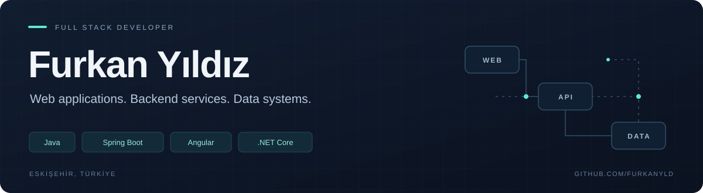

  

  <a href="https://www.linkedin.com/in/furkan-y%C4%B1ld%C4%B1z-584383254/">LinkedIn</a>
  &nbsp; · &nbsp;
  <a href="mailto:furkan16_yildiz@hotmail.com">Email</a>
  &nbsp; · &nbsp;
  <a href="https://github.com/furkanyld?tab=repositories">Explore my repositories</a>

I'm a **Full Stack Developer at Mergen Yazılım**, based in Eskişehir, Türkiye. I build web interfaces, backend services and data integrations, working primarily with **Java, Spring Boot and Angular**.

My experience spans healthcare software, database optimization and containerized deployments, with a background in **C#, .NET Core and Entity Framework Core**.

## What I work on

- **Connected clinical systems:** intensive care device data, live monitoring interfaces, device tracking and e-Nabız integrations.
- **Data-intensive applications:** laboratory query optimization, clinical calculations, blood bank and hemapheresis workflows.
- **Backend engineering:** APIs, service layers, authentication and authorization, and database schema design.
- **Replicated services:** Docker Compose, Docker Swarm, load balancing and Redis-based coordination for scheduled processing.

## Technical toolkit

| Area | Technologies |
| :--- | :--- |
| Backend | Java · Spring Boot · Spring Data JPA · Spring Security |
| Frontend | Angular · TypeScript · JavaScript |
| Databases | Oracle · PostgreSQL · MongoDB · SQL |
| Infrastructure | Docker · Docker Compose · Docker Swarm · Redis · Git |
| Earlier experience | C# · .NET Core · Entity Framework Core · Microsoft SQL Server |
| Additional project experience | Go / Gin · Python / Tesseract OCR |
| Basic familiarity | React · Android development with Java |

## Selected projects

### Kedostt
An animal adoption and donation platform connecting public applications with administrative workflows.

**Java · Spring Boot · Spring Security · PostgreSQL · React**

JWT authentication, role-based access, animal listings, adoption applications and donation endpoints.

[Backend repository](https://github.com/furkanyld/Kedostt-Backend) · [Frontend repository](https://github.com/furkanyld/Kedostt-Frontend)

### Concycle
A community platform for exchanging skills and assistance through contribution points.

**C# · .NET Core · Entity Framework Core · PostgreSQL · Angular · Android / Java**

Layered backend architecture with help requests, application approval and point transfers. Includes web and Android clients, plus a separate Spring backend repository.

[.NET backend](https://github.com/furkanyld/Concycle-Backend) · [Spring backend](https://github.com/furkanyld/Concycle-Backend-Spring) · [Web client](https://github.com/furkanyld/Concycle-Frontend) · [Android client](https://github.com/furkanyld/Concycle-Mobile)

### ExamEvaluatorAI
A team graduation project exploring handwritten exam evaluation through an OCR pipeline with fine-tuned Tesseract.

**Python · Tesseract OCR · Handwritten data preparation**

[Team repository](https://github.com/melihdemir0/ExamEvaluatorAI) · [Data preparation repository](https://github.com/furkanyld/TesseractOCR_Data_Preparation)

<strong>More projects</strong>

- [Notes Mobile App](https://github.com/furkanyld/Notes_Mobile_App) — Android note-taking application with a Go backend API.
- [TO-DO API](https://github.com/furkanyld/TO-DO-APP) — REST API built with Go and Gin.

## Currently exploring

Service replication, load balancing and coordination across containerized applications, building on my recent Docker Swarm and Redis work.
